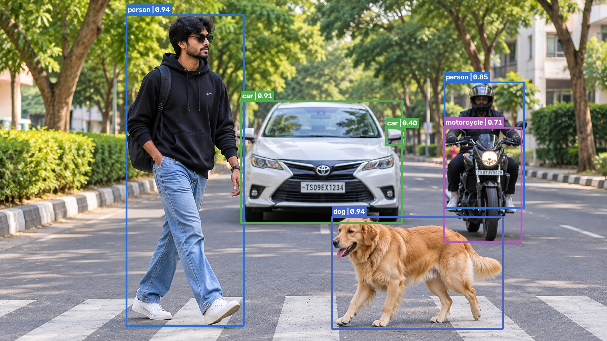

# EdgeAI Inference Engineering

EdgeAI is a computer-vision inference engineering project built around the pretrained YOLO11n detector. It explores how runtime, precision, hardware, preprocessing, postprocessing, and media I/O affect deployment—not just model execution time.

It includes local PyTorch and ONNX Runtime inference, reproducible benchmark tools, quantization experiments, a FastAPI service, and two distinct Streamlit experiences.

**Scope:** This is an engineering portfolio project, not a trained model, production service, or claim of universal speed or accuracy improvements. Results below are specific to their recorded inputs, machine, runtime, and timing methodology.

**Live demo:** [Try EdgeAI on Streamlit Community Cloud](https://edgeai-inference-engineering-hbw4y3fdgm6xygw5tusutp.streamlit.app/) · **Source:** [GitHub repository](https://github.com/Sohan-1908/edgeai-inference-engineering)

## Contents

- [Problem and motivation](#problem-and-motivation)
- [Features](#features)
- [Architecture](#architecture)
- [Technology](#technology)
- [Repository structure](#repository-structure)
- [Installation](#installation)
- [GPU environment](#gpu-environment)
- [CPU-only cloud demo](#cpu-only-cloud-demo)
- [Image inference](#image-inference)
- [Video inference and tracking](#video-inference-and-tracking)
- [ONNX precision experiments](#onnx-precision-experiments)
- [Benchmark results](#benchmark-results)
- [FastAPI service](#fastapi-service)
- [Streamlit dashboard](#streamlit-dashboard)
- [Tests and validation](#tests-and-validation)
- [Engineering findings](#engineering-findings)
- [Limitations and future work](#limitations-and-future-work)
- [Visuals](#visuals)

## Problem and motivation

Deploying a vision model involves more than selecting a smaller checkpoint. Runtime kernels, device placement, data conversion, preprocessing, postprocessing, video decoding, and output writing can all affect latency and throughput.

EdgeAI provides repeatable experiments across PyTorch and ONNX Runtime and keeps model-only, detector-call, and video-pipeline measurements distinct.

## Features

- YOLO11n image and video inference with PyTorch/Ultralytics or ONNX Runtime.
- Local ONNX CPU and CUDA execution; strict CUDA ONNX FP16 and CPU static INT8 experiments.
- Video and CUDA webcam inference; optional ByteTrack for PyTorch video/webcam flows.
- ONNX FP32/FP16/INT8 benchmarking, CPU operator profiling, graph diagnostics, and a separate experimental QOperator model.
- FastAPI image/video inference service with health/configuration endpoints and annotated outputs.
- HTTP-only Streamlit dashboard (`app.py`) for that API.
- Separate CPU-only ONNX Runtime Streamlit demonstration (`cloud_app.py`).
- Built-in sample image and video buttons in the cloud demo; video processing is capped at 20 seconds and 600 frames for the free CPU tier.
- Separate API/dashboard Dockerfiles and Compose configuration; container runtime validation is incomplete.

## Architecture

The local CLI, API service, and cloud demo are separate inference paths.

The API-backed dashboard does not run inference locally; it sends requests to FastAPI. The standalone cloud demo directly loads the FP32 ONNX model and executes inference on CPU.

See the [architecture diagram](docs/architecture.md) and [inference pipeline details](docs/inference_pipeline.md).

## Technology

Python 3.12; PyTorch 2.14; Ultralytics YOLO; ONNX Runtime 1.30; ONNX; OpenCV; NumPy; FastAPI/Uvicorn; Streamlit/Requests; ByteTrack; `unittest`.

- `requirements-gpu.txt` pins the full local CUDA-enabled PyTorch/ONNX Runtime stack.
- `requirements-api.txt` and `requirements-dashboard.txt` provide separate API and dashboard container dependency sets.
- `requirements.txt` contains the minimal CPU dependency set for the standalone cloud demo.

The generic `requirements.txt` is not a replacement for the full CLI/API development environment.

## Repository structure

```text
.
|-- main.py                         # CLI entry point
|-- app.py                          # Streamlit HTTP client for FastAPI
|-- cloud_app.py                    # Standalone CPU-only ONNX demo
|-- edgeai/                          # Detectors, API, media, tracking, benchmarks
|-- models/                          # Model artifacts and manifests
|   |-- experiments/                 # Separate QOperator INT8 experiment
|-- benchmarks/                      # Annotation benchmark
|-- tests/                            # unittest suite
|-- docs/                             # Architecture, API, setup and experiment docs
|-- outputs/                          # Local, generated and git-ignored experiment data
|-- controlled_benchmark.py           # Paired interleaved CPU FP32/QDQ benchmark
|-- profile_onnx_operators.py          # Separate ORT operator profiling runner
|-- analyze_ort_profile.py             # ORT trace analyzer
|-- diagnose_onnx_qdq.py               # ONNX graph/runtime diagnostics
|-- quantize_onnx_qoperator.py         # Experimental QOperator quantization
|-- benchmark_gpu_baseline.py          # Paired CUDA baseline runner
|-- benchmark_gpu_profile.py           # CUDA telemetry profiler
|-- requirements.txt                  # Minimal CPU cloud-demo dependencies
|-- requirements-gpu.txt              # Full CUDA-enabled local environment
|-- requirements-api.txt              # API/container dependencies
|-- requirements-dashboard.txt        # Dashboard/container dependencies
|-- Dockerfile.api
|-- Dockerfile.dashboard
`-- compose.yaml
```

Generated models, benchmark reports, traces, and most files under `outputs/` are local artifacts and are excluded by `.gitignore`. The QOperator experiment script and its tests are included separately from its generated model artifact.

## Installation

### Full local development environment (Windows PowerShell)

The checked-in full local environment is pinned in `requirements-gpu.txt`. Use a compatible 64-bit Python 3.12 installation:

```powershell
py -3.12 -m venv .venv
.\.venv\Scripts\Activate.ps1
python -m pip install --upgrade pip
python -m pip install -r requirements-gpu.txt
```

The repository includes `yolo11n.pt` and static ONNX artifacts in `models/`. Some PyTorch workflows may download weights if their requested checkpoint is not present.

The GPU requirements install CUDA-enabled dependencies. CLI ONNX inference supports CPU when run with `--device cpu`, but there is no separately pinned CPU-only environment for the complete CLI. The standalone cloud demo has its own minimal CPU requirements and entry point below.

## GPU environment

The recorded GPU experiments ran on Windows 11 with an NVIDIA GeForce RTX 3050 Laptop GPU (4 GB), PyTorch 2.14.0+cu130, and ONNX Runtime 1.30.0.

Local CUDA inference requires a compatible NVIDIA driver and CUDA-enabled dependencies. The project's PyTorch CUDA wheel index is specified in `requirements-gpu.txt`; a separate CUDA Toolkit installation is not specified by the project.

PyTorch CUDA inference and ONNX Runtime CUDA inference are separate runtime paths. Strict ONNX CUDA runs require `CUDAExecutionProvider`; FP16 is CUDA-only and does not silently fall back unless `--allow-fp32-fallback` is requested. The CPU INT8 workflow must use CPU and is not a CUDA quantization path.

## CPU-only cloud demo

`cloud_app.py` is a standalone Streamlit app. It loads `models/yolo11n.onnx` and runs it through `CPUExecutionProvider` in the same process.

It does **not** call FastAPI or use the API-backed dashboard's model-free HTTP architecture. It is intended as a lightweight demonstration, not a CUDA deployment or performance comparison.

Run the app locally in an isolated Python 3.12 environment:

```powershell
py -3.12 -m venv .venv-cloud
.\.venv-cloud\Scripts\Activate.ps1
python -m pip install --upgrade pip
python -m pip install -r requirements.txt
python -m streamlit run cloud_app.py
```

The cloud app needs the FP32 ONNX artifact at `models/yolo11n.onnx`. A hosted deployment also needs that model available in its repository/build and a compatible Python/dependency setup.

Open the [live CPU demo](https://edgeai-inference-engineering-hbw4y3fdgm6xygw5tusutp.streamlit.app/). The app runs on CPU; cold starts and video processing can take a little while.

## Image inference

From the activated full environment:

```powershell
# PyTorch on CUDA when available
python main.py --image edgeai_annotated.jpg --runtime pytorch --device cuda

# ONNX Runtime CPU
python main.py --image edgeai_annotated.jpg --runtime onnx --device cpu --onnx-model models\yolo11n.onnx

# ONNX Runtime CUDA
python main.py --image edgeai_annotated.jpg --runtime onnx --device cuda --onnx-model models\yolo11n.onnx
```

The CLI saves annotated output under `outputs/` by default; change this with `--output-dir`. ONNX exports have fixed square input sizes of 640, 480, or 320, so use a model artifact matching `--imgsz`.

## Video inference and tracking

```powershell
# PyTorch video inference
python main.py --video demo_video.mp4 --runtime pytorch --device cuda

# PyTorch video inference with ByteTrack IDs
python main.py --video demo_video.mp4 --runtime pytorch --device cuda --track

# ONNX Runtime CPU video inference (tracking is not supported)
python main.py --video demo_video.mp4 --runtime onnx --device cpu --onnx-model models\yolo11n.onnx

# Optional CUDA webcam inference; requires a connected camera
python main.py --webcam --device cuda
```

ByteTrack is supported only with PyTorch in the current implementation; ONNX tracking requests are rejected. Webcam inference is local, requires CUDA, and is not available in either Streamlit app.

## ONNX precision experiments

Existing artifacts are separate files:

- FP32: `models/yolo11n.onnx`
- FP16: `models/yolo11n_fp16.onnx`
- QDQ INT8: `models/yolo11n_int8.onnx`

Do not overwrite the FP32 or QDQ artifacts when experimenting.

```powershell
# Export a static FP32 ONNX model from YOLO weights
python main.py --export-onnx --model yolo11n.pt --imgsz 640

# Convert to a separate FP16 ONNX artifact (requires CUDA validation)
python main.py --convert-fp16 --onnx-model models\yolo11n.onnx --fp16-model models\yolo11n_fp16.onnx

# Create the static QDQ INT8 model
python main.py --quantize-int8

# Run the precision-specific artifacts
python main.py --image edgeai_annotated.jpg --runtime onnx --precision fp16 --device cuda
python main.py --image edgeai_annotated.jpg --runtime onnx --precision int8 --device cpu
```

**INT8 calibration input requirement:** The default calibration video is a local, git-ignored artifact and is not included in a clean clone. Supply your own video using `--calibration-video`:

```powershell
python main.py --quantize-int8 --calibration-video path\to\your_video.mp4
```

Alternatively, supply at least four local calibration images using `--calibration-images`:

```powershell
python main.py --quantize-int8 --calibration-images image1.jpg image2.jpg image3.jpg image4.jpg
```

When `--calibration-images` is supplied, the explicit images are used instead of the default calibration video.

The separate QOperator INT8 experiment and the paired CPU benchmark are independent of production defaults.

```powershell
# Inspect the experiment-specific options
python quantize_onnx_qoperator.py --help
python controlled_benchmark.py --help
```

These experiments require existing model artifacts and benchmark inputs. See the experiment-specific prerequisites before execution.

Operator profiling also runs separately, not during ordinary benchmarks:

```powershell
python profile_onnx_operators.py --help
python analyze_ort_profile.py --help
python diagnose_onnx_qdq.py --help
```

Use each tool's help for required manifest and output arguments. See [optimization experiment notes](docs/OPTIMIZATION.md) for the documented quantization policy and caveats.

## Benchmark results

These are separate experiments with different scopes and should not be combined into one runtime ranking. GPU numbers are CUDA video-run measurements; CPU numbers are CPU image inference measurements. No result establishes general performance on other hardware or data.

### Local GPU video: ONNX FP32 vs FP16

Source: 62-frame, 640×360, 30 FPS clip; 640×640 model input; CUDAExecutionProvider; no tracking. The report processed 62 frames in each run, including three warm-up frames.

The metrics below are reported separately because they measure different scopes.

| Metric | FP32 ONNX CUDA | FP16 ONNX CUDA |
|---|---:|---:|
| Model-only mean latency | 15.622 ms | 16.744 ms |
| Model-only FPS (model execution timing) | 64.01 | 59.72 |
| Full detector-call mean latency (preprocess + inference + postprocess) | 26.686 ms | 27.499 ms |
| Measured video-pipeline latency per measured frame* | 32.75 ms | 33.41 ms |
| Measured video-pipeline FPS (decode, inference, annotation, writing, release) | 30.53 | 29.93 |
| Whole-video processing FPS (all 62 frames / total processing time) | 18.64 | 14.17 |
| Total video processing time | 3.326 s | 4.375 s |
| Model file size | 10.70 MB | 5.41 MB |

\*Measured-pipeline latency per frame is calculated as `1000 / measured video-pipeline FPS`; it is not the detector-call latency.

FP16 reduced file size by about **49.5%**, but was slower in model-only latency/FPS and on the video-pipeline measures for this run. These figures are not CPU results and do not imply a CUDA speedup.

### Local CPU image inference: controlled FP32 vs QDQ INT8

These controlled CPU experiments compare FP32 ONNX and QDQ INT8 ONNX using `CPUExecutionProvider`. Results are machine-specific measurements, not dataset-level accuracy or general performance certifications.

#### Earlier controlled run

The earlier paired CPU baseline used four images from one video, four intra-op threads, one inter-op thread, 10 warm-ups, and 50 measured inferences per model per trial over three interleaved trials (FP32 → QDQ, QDQ → FP32, FP32 → QDQ). Profiling was disabled.

| Metric | FP32 ONNX CPU | QDQ INT8 ONNX CPU |
|---|---:|---:|
| Mean full inference latency | 45.280 ms | 73.120 ms |
| Median latency | 45.398 ms | 72.245 ms |
| P95 latency | 49.111 ms | 80.664 ms |
| Standard deviation | 2.550 ms | 6.157 ms |
| Throughput | 22.08 FPS | 13.68 FPS |

In this run, QDQ INT8 was approximately **61.5% slower** than FP32.

#### Subsequent controlled run — November 4, 2026

A subsequent run of the controlled benchmark recorded these results:

| Metric | FP32 ONNX CPU | QDQ INT8 ONNX CPU |
|---|---:|---:|
| Mean full inference latency | 41.951 ms | 61.787 ms |
| Median latency | 42.692 ms | 60.453 ms |
| P95 latency | 46.107 ms | 70.574 ms |
| Standard deviation | 3.676 ms | 4.322 ms |

QDQ INT8 was approximately **47.3% slower** than FP32 in this run.

These are separate measurements, so differences between runs should not be interpreted as a change in model quality or a general performance trend. Both runs found FP32 faster under their respective CPU test conditions.

The November 4 report and raw measurements are retained locally under `outputs/controlled_benchmarks/20261104T130331564433Z/`. These generated artifacts are excluded from Git; their numerical summary is preserved here.

### Earlier CPU experiment and separate QOperator run

The earlier Phase 7B run used the same four sampled frames and reported FP32 mean latency **56.791 ms** and QDQ INT8 **77.891 ms**. Its INT8 model was about **51.4% smaller** by file size.

Those cross-date measurements are **not directly comparable** with the later controlled run: runtime CPU load and other environment factors were not captured in Phase 7B, and the timing discrepancy was investigated separately.

The separate QOperator experiment reported mean latencies of:

- **496.970 ms** — FP32
- **725.350 ms** — QDQ INT8
- **1316.846 ms** — QOperator INT8

This was a distinct run with the previously observed system-level timing drift; **do not treat it as a controlled three-way comparison with the later FP32/QDQ baseline**.

The optimized experimental graph retained 56 QLinearConv nodes alongside 32 floating-point Conv nodes, and the separate CPU execution trace recorded QLinearConv on CPUExecutionProvider. Nevertheless, the QOperator model was not faster in that run. ORT warned that signed INT8 activations and weights in QOperator format may perform poorly on x64.

The CPU INT8 and QOperator experiments used only four images sampled from one video. The accuracy comparisons are limited checks against FP32 on those frames, not dataset-level evaluation, ground-truth accuracy, or certification.

## FastAPI service

The FastAPI backend owns model loading and inference. It currently requires CUDA and supports PyTorch FP32 or strict CUDA ONNX FP32; it is not the CPU cloud-demo backend.

Configure the runtime before startup:

```powershell
$env:EDGEAI_API_RUNTIME = "pytorch" # or "onnx"
$env:EDGEAI_API_DEVICE = "cuda"
python -m uvicorn edgeai.api:app --host 127.0.0.1 --port 8000
```

The service also reads model/input size and upload/video limits from `EDGEAI_API_*` environment settings; defaults and configuration details are in [API documentation](docs/API.md).

Core routes:

| Method | Endpoint | Purpose |
|---|---|---|
| GET | `/health` | Readiness, active runtime/device, and input resolution |
| GET | `/api/v1/config` | Runtime/model configuration and supported settings |
| POST | `/api/v1/detect` | JPG/JPEG/PNG image inference; JSON detections/timings and optional annotated image |
| POST | `/api/v1/detect/video` | MP4/AVI annotated video stream; metrics in `X-EdgeAI-Metadata` |

OpenAPI documentation is available at `/docs` while the service is running. Video limits and codec support apply; tracking is PyTorch-only.

## Streamlit dashboard

`app.py` is the dashboard for the FastAPI service. It sends HTTP requests through `edgeai/api_client.py`; it does not load models or execute inference.

Start the dashboard in another terminal after the API is ready:

```powershell
$env:EDGEAI_API_BASE_URL = "http://127.0.0.1:8000"
python -m streamlit run app.py
```

It provides image upload and detections, video upload and metadata, and annotated-video download. The active runtime is selected by the API environment, not per request. ByteTrack is offered only for a PyTorch API backend.

This local API-backed dashboard is distinct from the standalone `cloud_app.py` CPU demo described above.

## Tests and validation

Run the repository's unittest suite:

```powershell
python -m unittest discover -s tests -v
```

The latest recorded full-suite validation is **PARTIAL**: 153 tests passed cumulatively; 19 API-related tests remained unvalidated; zero completed assertion failures were recorded.

These counts are historical cumulative results, not one full-suite pass.

Separate profiling, graph-diagnostic, QOperator, and controlled-benchmark tests have also been run. In the current workspace, the following targeted test groups passed:

- Controlled benchmark, ONNX profiling, QDQ diagnostics, QOperator experiment, and ORT operator profiling: 28 tests.
- ONNX detection and profiling: 15 tests.

Across these overlapping test runs, **38 unique targeted tests passed** (43 test executions; the five profiling tests were run twice). Live API/dashboard connectivity and Docker runtime checks remain outstanding.

See the [Phase 19C validation report](docs/phase19c_final_validation_report.md).

## Engineering findings

- PyTorch CUDA, ONNX Runtime CUDA, and ONNX Runtime CPU are different execution paths; provider/device must be stated with any performance result.
- FP16 reduced the GPU model file size by about half but did not improve the reported GPU video speed.
- QDQ INT8 was smaller but slower than FP32 in both CPU reports. A smaller artifact alone does not guarantee faster CPU inference: quantize/dequantize operations, unquantized graph regions, memory/layout work, and available kernel implementations affect total cost.
- In the QOperator experiment, CPU QLinearConv execution was directly observed, but end-to-end inference was still slower. A quantized operator appearing in a graph is not by itself evidence of a speedup.
- Profiled operator durations include profiling overhead and are not interchangeable with unprofiled end-to-end latencies.
- Four frames from one video are useful for a bounded experiment, not broad workload or accuracy validation.
- The Phase 18 optimization decision was NO-GO for speculative production optimizations; changes require correctness checks and repeated, comparable end-to-end measurements.

## Limitations and future work

- The FastAPI service is CUDA-only; no CPU API deployment is implemented.
- `app.py` requires a reachable FastAPI service and does not support live webcam streaming, authentication, or persistent job history.
- The standalone CPU cloud demo and API-backed dashboard are different applications; the linked cloud demo does not provide local CUDA inference.
- Dense scenes can still have overlapping labels when shown at 640×360; smaller labels would reduce readability.
- Dockerfiles and Compose configuration exist, but container startup/build and NVIDIA container access were not verified.
- The full test suite is not fully validated; 19 API-related tests remain outstanding, and live service checks have not passed in the restricted environment.
- Fixed-shape ONNX exports require a matching model resolution. Video support depends on installed OpenCV codecs.
- Benchmark and small-frame detection comparisons do not establish dataset-level accuracy or general real-time performance.

Recommended next steps are to finish the API/live/container validation on an unrestricted machine, gather a broader representative accuracy set, and capture real UI screenshots before public presentation.

## Visuals

### Cloud demo

[Open the live EdgeAI demo](https://edgeai-inference-engineering-hbw4y3fdgm6xygw5tusutp.streamlit.app/) or use the sample image/video buttons to see the UI without preparing a file.

The repository also includes this tracked annotated inference result:



Do not present the cloud CPU demo as the local CUDA-backed FastAPI deployment.
