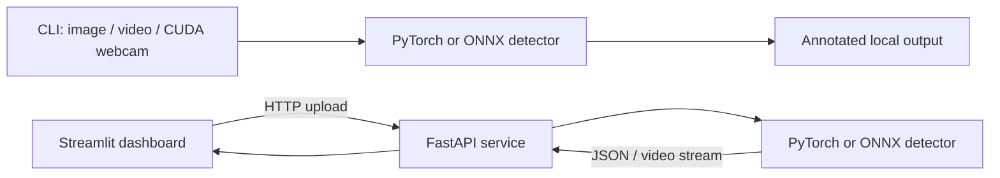

# EdgeAI — Real-Time Vision Inference

EdgeAI is a computer-vision inference engineering project built around the pretrained YOLO11n detector. It runs image, video, and CUDA webcam inference with PyTorch or ONNX Runtime, offers optional PyTorch-only ByteTrack tracking, and exposes image/video inference through FastAPI and an HTTP-only Streamlit dashboard.

The project explores inference runtime behavior, CUDA execution, media processing, API integration, and reproducible performance measurement. It does not train a model or claim guaranteed real-time performance.

## Objectives

- Provide consistent image and video inference workflows across PyTorch and ONNX Runtime.
- Keep inference in the CLI or FastAPI backend; the dashboard is a frontend client.
- Measure model execution and broader inference-call costs distinctly.
- Preserve experiment evidence and avoid production optimizations unsupported by end-to-end measurements.

## Implemented features

- CLI image and video detection, CUDA webcam inference, annotation, and structured detection results.
- PyTorch YOLO11n and FP32 ONNX Runtime inference; CPU execution is available to supported CLI paths.
- Optional ByteTrack for PyTorch video and webcam workflows; ONNX tracking is not supported.
- FastAPI CUDA-only image/video service with health/config endpoints, upload validation, timing metadata, and streamed annotated video.
- Streamlit image/video dashboard that communicates with FastAPI over HTTP and does not load models.
- Separate FP16 and partial INT8 experiments, input-resolution and runtime benchmarks, and profiling utilities.
- Dockerfiles and Compose configuration for separate API and dashboard services; container runtime validation remains outstanding.

## Technology

Python 3.12; PyTorch; Ultralytics YOLO; ONNX Runtime; OpenCV; NumPy; FastAPI/Uvicorn; Streamlit/Requests; ByteTrack; unittest; Docker Compose configuration.

## Architecture

The CLI and service are separate inference paths. In the service path, Streamlit submits media to FastAPI; FastAPI owns model initialization and inference. See the [architecture diagram](docs/architecture.md) and [inference pipeline](docs/inference_pipeline.md).



## Inference and CUDA configuration

PyTorch inference delegates preprocessing, model execution, and prediction postprocessing to Ultralytics; the detector synchronizes CUDA around the measured prediction call. ONNX inference uses the project's fixed-shape preprocessing and output decoder around a synchronous ONNX Runtime session. Strict ONNX CUDA runs require `CUDAExecutionProvider`; the GPU benchmark disables CPU fallback.

CLI image and file-video inference accept `--device auto`, `cpu`, or `cuda`, subject to runtime/model support. The webcam and FastAPI service require CUDA and do not silently fall back to CPU. The API supports PyTorch FP32 or strict CUDA ONNX FP32. ByteTrack is PyTorch-only.

## Benchmark snapshot

The designated Phase 16B baseline and unchanged Phase 17A repeat use YOLO11n, one 810 × 1080 source image, 640 × 640 input, batch 1, FP32, 10 warm-ups, 30 measured calls per trial, and 3 paired trials. Full-call latency is wall-clock time around `predict_frame`; model-execution timing is reported separately.

| Runtime | Run | Full-call mean / median (ms) | Model execution mean (ms) | Pooled full-call throughput |
|---|---|---:|---:|---:|
| PyTorch CUDA | Phase 16B | 82.232 / 76.060 | 64.814 | 12.161 FPS |
| ONNX Runtime CUDA | Phase 16B | 55.734 / 54.469 | 36.652 | 17.942 FPS |
| PyTorch CUDA | Phase 17A repeat | 80.606 / 79.066 | 63.477 | 12.406 FPS |
| ONNX Runtime CUDA | Phase 17A repeat | 59.732 / 57.905 | 37.861 | 16.742 FPS |

These are experiment-specific measurements, not guarantees. Phase 16C used a different worker and telemetry methodology and showed an unresolved latency/order discrepancy; its measurements are not presented as an optimization. Isolated Phase 17B/17C timings do not establish end-to-end bottlenecks. Phase 18 decided **NO-GO** on speculative production optimization. See [benchmark results and limitations](docs/benchmark_results.md).

## Setup

The recorded local benchmark environment was 64-bit Windows 11, Python 3.12.10, an NVIDIA RTX 3050 Laptop GPU, PyTorch 2.14.0+cu130, and ONNX Runtime 1.30.0. The requirements file pins a CUDA-enabled PyTorch stack; a compatible NVIDIA driver and supported CUDA runtime are required for CUDA execution. ONNX model files for the chosen input resolution must exist locally.

Windows PowerShell setup commands (documented; dependency installation was not performed as part of Phase 20):

```powershell
py -3.12 -m venv .venv
.\.venv\Scripts\Activate.ps1
python -m pip install -r requirements.txt
```

For environment variables, model paths, API settings, and reproducible benchmark commands, see the [setup and reproduction guide](docs/setup_and_reproduction.md).

## Run the application

From the activated environment:

```powershell
python main.py --image outputs\smoke_input.jpg --device auto
python main.py --video demo_video.mp4 --device auto
python main.py --video demo_video.mp4 --track --runtime pytorch
```

For webcam inference, use a CUDA-capable environment and a connected camera:

```powershell
python main.py --webcam --device cuda
```

Start the CUDA-only FastAPI backend:

```powershell
$env:EDGEAI_API_RUNTIME = "pytorch" # or "onnx"
$env:EDGEAI_API_DEVICE = "cuda"
python -m uvicorn edgeai.api:app --host 127.0.0.1 --port 8000
```

In another terminal, launch the HTTP-only dashboard:

```powershell
$env:EDGEAI_API_BASE_URL = "http://127.0.0.1:8000"
python -m streamlit run app.py
```

The API also serves `/health`, `/api/v1/config`, `/docs`, image inference at `/api/v1/detect`, and video inference at `/api/v1/detect/video`. Video metrics are returned in `X-EdgeAI-Metadata`. These launch commands are documented, but live API/dashboard health checks were not completed in the sandbox because localhost access was blocked. See [API documentation](docs/API.md) and [dashboard documentation](docs/DASHBOARD.md).

## Testing and validation

Run the documented suite:

```powershell
python -m unittest discover -s tests -v
```

**Latest recorded validation: PARTIAL.** A cumulative 153 tests passed across completed runs; 19 API tests remained unvalidated because Windows asyncio/TestClient socket setup stalled in the restricted environment. Zero completed assertion failures were recorded. Live FastAPI/Streamlit checks were blocked by sandbox localhost restrictions, and Docker runtime validation was unavailable. This is not a full-suite pass. See the [Phase 19C final validation report](outputs/phase19c_final_validation_report.md).

## Limitations and future work

- No live webcam stream in the dashboard, user authentication, persistent job history, or model training.
- API inference requires CUDA; Docker deployment requires a functioning Docker engine and NVIDIA GPU access.
- ONNX exports have fixed input shapes; select the matching 640, 480, or 320 artifact.
- OpenCV codec support determines which video files can be decoded and written.
- Detection quality depends on the pretrained YOLO11n model and has not been established by the performance benchmarks.
- Benchmarks are hardware-, runtime-, workload-, and methodology-specific. They do not prove general 30 FPS performance or GPU bottlenecks.
- Full API tests and live service/container checks should be rerun in an unrestricted local environment.

Reasonable next steps are to close the remaining API validation gap, run the documented live/container checks where resources permit, and consider optimizations only after equivalent before/after end-to-end measurements.

## Project structure

```text
.
├── app.py                         # Streamlit HTTP client
├── main.py                        # CLI entry point
├── edgeai/                        # Inference, API, media, tracking, benchmarks
├── models/                        # ONNX exports and manifests
├── benchmarks/                    # Annotation benchmark and results
├── tests/                         # unittest suite
├── docs/                          # API, dashboard, pipeline, setup, benchmarks
├── outputs/                       # Benchmark and validation artifacts
├── benchmark_gpu_baseline.py      # Paired CUDA baseline runner
├── benchmark_gpu_profile.py       # GPU telemetry profiler
├── benchmark_onnx_preprocessing.py
├── benchmark_onnx_postprocessing.py
├── requirements.txt
├── requirements-api.txt
├── requirements-dashboard.txt
├── Dockerfile.api
├── Dockerfile.dashboard
└── compose.yaml
```

## Documentation

- [Architecture](docs/architecture.md)
- [Inference pipeline](docs/inference_pipeline.md)
- [Benchmark results](docs/benchmark_results.md)
- [Setup and reproduction](docs/setup_and_reproduction.md)
- [API](docs/API.md) · [Dashboard](docs/DASHBOARD.md) · [Webcam](docs/WEBCAM.md)
- [Existing benchmark methodology](docs/BENCHMARKS.md) · [Optimization experiments](docs/OPTIMIZATION.md)
- [Phase 16–19 experiment and validation reports](outputs/)
