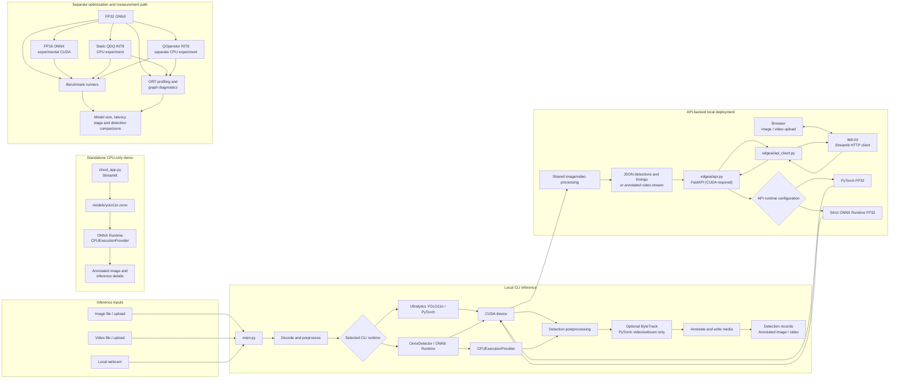

# EdgeAI Architecture

EdgeAI contains three inference entry paths and a separate model-optimization workflow. The production/default detector selection is not changed by the experimental FP16, QDQ INT8, or QOperator artifacts.

## System overview

## Verified execution paths

### Local CLI

`main.py` accepts image, video, webcam, export, conversion, quantization, and benchmark modes. The local image/video path can select the PyTorch detector or ONNX Runtime, and the ONNX session can execute on CPU or CUDA where the selected precision supports it. ONNX models have fixed input shapes; the model resolution and requested input size must match.

The ONNX detector performs its own letterbox preprocessing and output decoding. The PyTorch detector delegates model preprocessing/execution/postprocessing to Ultralytics. Both paths produce EdgeAI detection records and annotated media. ByteTrack is integrated for PyTorch video and webcam flows; ONNX tracking is rejected.

### FastAPI and local Streamlit dashboard

`edgeai/api.py` initializes a CUDA detector during service lifespan. Configurable API runtimes are PyTorch FP32 or strict CUDA ONNX FP32. The service does not provide CPU fallback. Image inference is returned as structured JSON, with optional annotated image data. Video inference streams annotated bytes and includes processing metadata in the `X-EdgeAI-Metadata` header.

`app.py` is an HTTP-only frontend. It uses `edgeai/api_client.py` to query health/configuration and submit image/video uploads. It does not import the inference engine to run detection or load model files. The API controls runtime selection; the dashboard does not select runtime per request. ByteTrack is available only when the API backend is configured for PyTorch.

### Standalone CPU cloud demo

`cloud_app.py` is a separate Streamlit application that loads `models/yolo11n.onnx` directly and explicitly uses `CPUExecutionProvider`. It is not the `app.py` dashboard, does not call FastAPI, and does not provide local CUDA execution. Hosted deployment was not validated.

### Experimental optimization path

FP32 ONNX is the source artifact for two separate paths:

- FP16 conversion keeps public model I/O in FP32, is intended for strict ONNX Runtime CUDA execution, and writes a separate artifact.
- Static QDQ INT8 uses calibration and quantizes selected Conv nodes; other operations and selected excluded regions remain floating point. Its tested execution path is ONNX Runtime CPU.
- QOperator INT8 is an isolated experiment. In the recorded experiment, the optimized graph retained 56 `QLinearConv` nodes and 32 floating-point `Conv` nodes, and profiling observed `QLinearConv` on `CPUExecutionProvider`. The model was slower in that run; its existence is not evidence of a production speedup.

Benchmark runners measure different scopes (model execution, full detector call, and video processing). Operator-profiled timings are kept separate from unprofiled benchmark latency because profiling adds overhead.

## Deployment and validation status

The repository includes separate API and dashboard Dockerfiles and a Compose configuration that requests an NVIDIA GPU for the API. Docker build/runtime behavior and NVIDIA container access remain unvalidated. The API-backed local deployment requires CUDA; the standalone CPU cloud app is a separate demonstration, not an equivalent substitute.

See the [inference pipeline](inference_pipeline.md), [API guide](API.md), [dashboard guide](DASHBOARD.md), [setup and reproduction notes](setup_and_reproduction.md), and [benchmark findings](benchmark_results.md) for additional detail.
