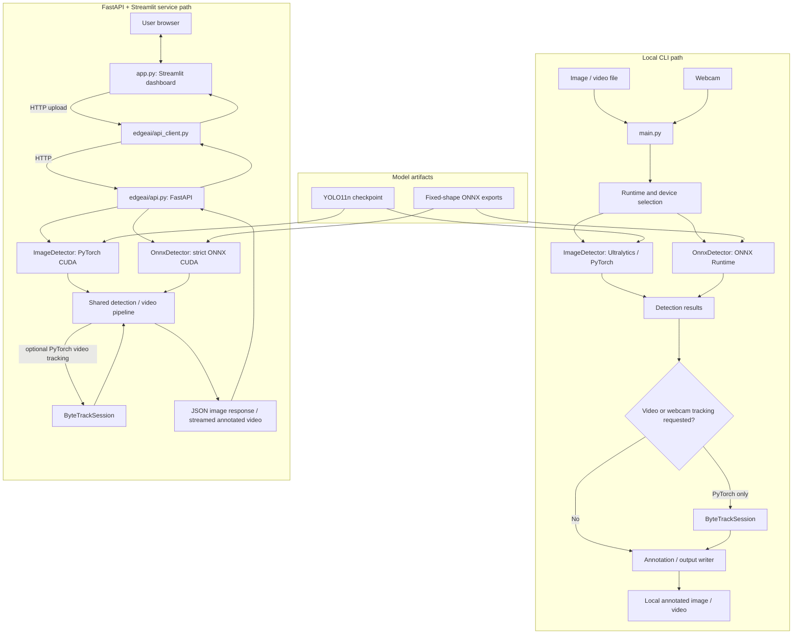
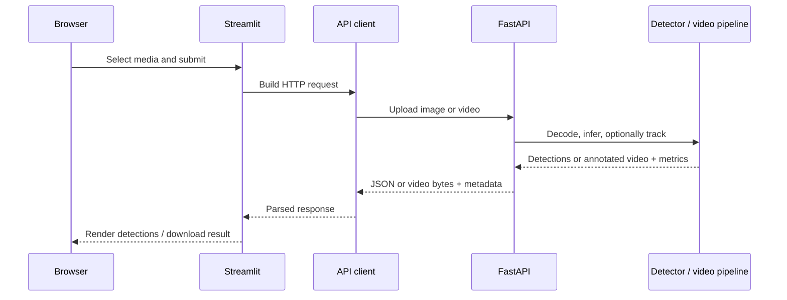

# EdgeAI Architecture

EdgeAI has two implemented execution paths: a local CLI path and an HTTP service path. They share detector, media-processing, tracking, and annotation code. The Streamlit dashboard is only an HTTP client; it does not initialize models or run inference.

## Component diagram

## Ownership and boundaries

- **CLI (`main.py`)** selects local file, webcam, export, and benchmark workflows. It chooses the configured PyTorch or ONNX detector where the selected mode supports it.
- **PyTorch detector (`edgeai/detector.py`)** wraps the Ultralytics model. CUDA inference is synchronized around the prediction call for timing.
- **ONNX detector (`edgeai/onnx_detector.py`)** performs the project's ONNX preprocessing and decoding around an ONNX Runtime session. Strict CUDA initialization verifies `CUDAExecutionProvider`; other CLI modes can support CPU depending on options.
- **Video pipeline (`edgeai/video.py`)** reads and processes frames, calls the existing detector, optionally updates ByteTrack, annotates frames, and writes the output video.
- **Tracking (`edgeai/tracking.py`)** wraps Ultralytics ByteTrack for a per-video PyTorch tracking session. ONNX tracking is rejected.
- **FastAPI (`edgeai/api.py`)** initializes one CUDA detector during application lifespan, validates requests, runs inference off the event loop, and returns JSON or streamed video. It does not provide a CPU fallback.
- **Streamlit (`app.py`)** uses the reusable requests-based client in `edgeai/api_client.py` to query health/configuration and submit image/video uploads.
- **Docker configuration** describes separate API and dashboard services. It requires a working engine and NVIDIA GPU access for API inference; container execution has not been validated in the latest audit.

## Service data flow

For image requests, the API returns structured detections and timing fields; the annotated JPEG is optional and base64-encoded. For video requests, annotated bytes are streamed and processing metadata is serialized in the `X-EdgeAI-Metadata` header. Temporary video files are request-scoped and cleaned after completion or failure.

## Runtime constraints

The API supports PyTorch FP32 or strict CUDA ONNX FP32, requires CUDA, and verifies the active device/provider at startup. The CLI has broader CPU support for file inference. Fixed-shape ONNX models are provided for 640, 480, and 320 input sizes; the selected model must match the requested size. See [API configuration](API.md) and the [setup and reproduction guide](setup_and_reproduction.md).
